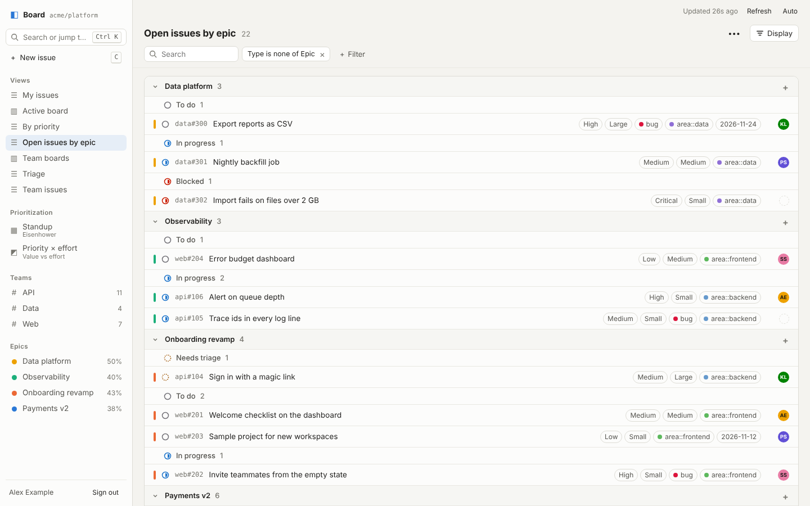
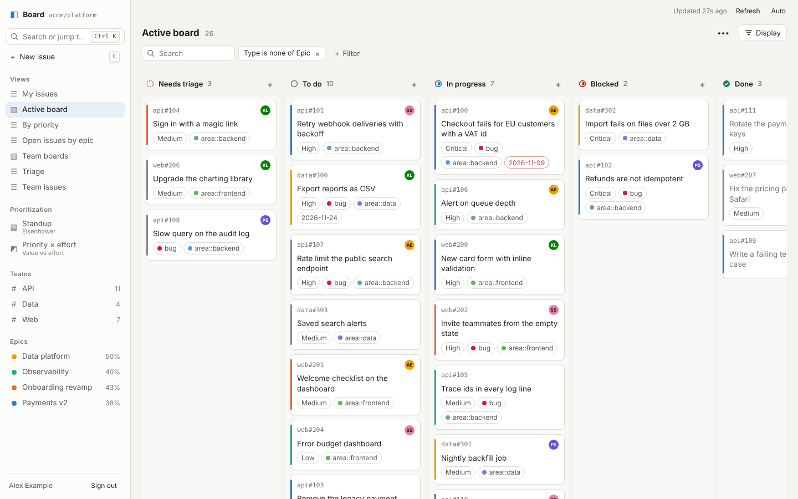
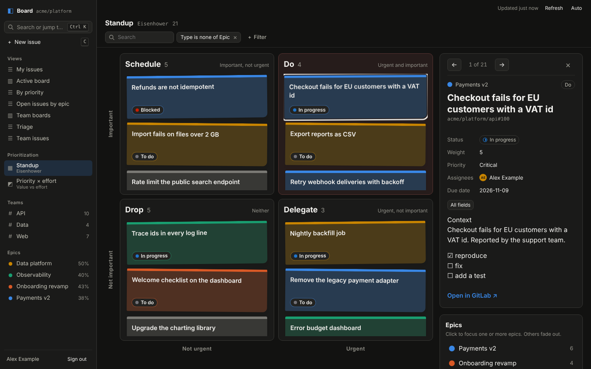
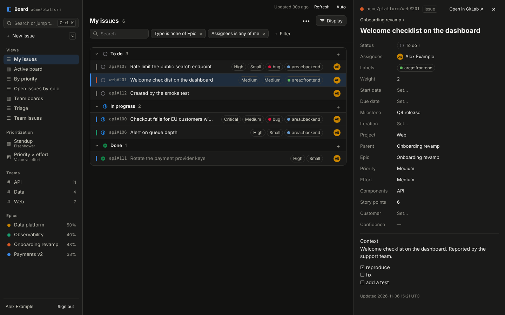
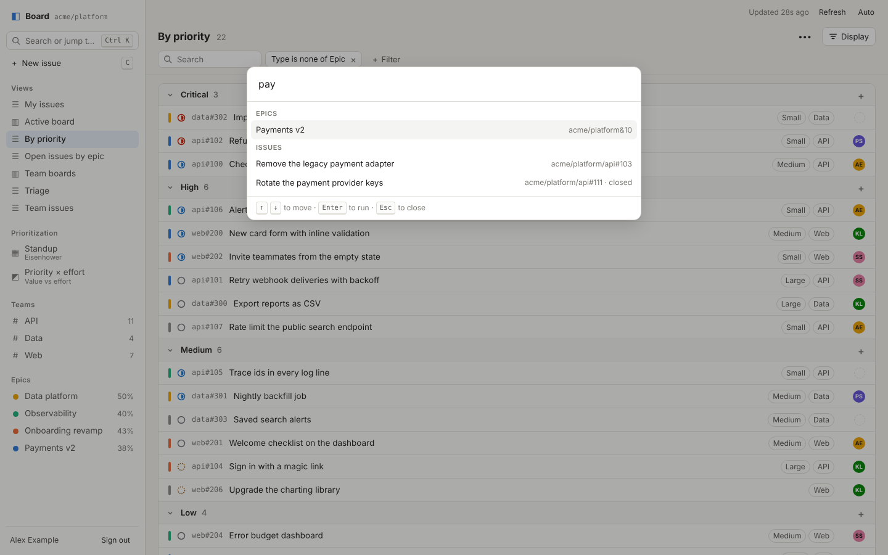

# Board: Linear-style views on GitLab

A Linear-like board for a GitLab group's work items, built with SvelteKit 2 and Svelte 5.
Views show issues as a **List** or a **Board** (kanban). A separate **Prioritization** section shows them
through prioritization frameworks: the standup **Eisenhower matrix** today, more tools later.
Everyone signs in with their own GitLab account, sees only what GitLab lets them see, and can edit
issues from the board. A wall screen can run a read-only **kiosk**.



| | |
|---|---|
|  |  |
|  |  |

More in [`docs/screenshots/`](docs/screenshots/) (each in light and dark).

## What it does

- **Views** (Linear-style): filter chips built from your fields, grouping and sub-grouping, ordering,
  visible properties, sub-issues nested / flat / hidden, completed issues (All / Past day / Past week /
  Past month / None), empty groups. Default views live in [`src/lib/views.config.ts`](src/lib/views.config.ts);
  everyone can save their own views in their browser, share a view as a link, and export/import JSON.
- **Layouts:** List, and Board (columns from any single-select field, status, people, parent or epic;
  optional swimlanes; drag to update).
- **Prioritization:** named tools in their own sidebar section, each an instance of a *tool type*:
  **Eisenhower** (urgent × important → Do / Schedule / Delegate / Drop, with the standup walk-through and
  epic colors) and **Value vs effort** (Quick wins / Big bets / Fill-ins / Reconsider). Axes come from any
  ordered field. Instances live in [`src/lib/prioritization.config.ts`](src/lib/prioritization.config.ts);
  see [Prioritization tools](#prioritization-tools).
- **Editing:** status, any custom field, assignees, parent epic, title, weight, start/due date, labels
  (scoped labels stay exclusive), milestone, iteration, and *create issue* pre-filled from the current view.
  Changes show at once and roll back with a message if GitLab refuses them.
- **Teams = projects, epics with progress:** the sidebar lists projects with open work and open epics;
  `/epics` lists epics with progress from GitLab's rolled-up counts; `/epics/<id>` shows an epic's issues
  through any view.
- **Custom fields are discovered at runtime.** No code or default config depends on a field name or option
  value. A new, renamed, reordered or removed field or option shows up after the next schema refresh
  (≤ 10 minutes). A view that refers to a field that's gone still loads: the rule shows as a struck-through
  "field removed" chip and is ignored.
- **Keyboard:** `⌘/Ctrl K` command palette · `j`/`k` or `↑`/`↓` move · `Enter` open · `Esc` close ·
  `c` create · `s` status · `a` assignees · `l` labels · `w` weight · `g` then `1`–`9` go to a view ·
  `g e` epics · on a board, `Alt`+`←`/`→` moves the focused card · in an Eisenhower matrix, `←`/`→` (or `j`/`k`) walk the board.

## Run it

```sh
cp .env.example .env      # fill in the GitLab and sign-in settings (see below)
npm install
npm run dev               # http://localhost:5173
```

Production (Node server via `@sveltejs/adapter-node`):

```sh
npm run build
ORIGIN=https://board.example.internal PORT=3000 npm start
```

`ORIGIN` must be the public URL people open. It's used to build the OAuth redirect URI and for the
same-origin checks on sign-out and on every write.

### Try it without GitLab

`scripts/fake-gitlab.mjs` is a tiny fake GitLab (OAuth + the GraphQL operations the board sends, with
demo data, writes kept in memory). It's what the smoke tests and screenshots use.

```sh
node scripts/fake-gitlab.mjs &                     # http://localhost:4010
. scripts/dev-env.sh && npm run dev                # board on http://localhost:5173, signs in with no password
```

## Environment variables

| Variable | Default | |
|---|---|---|
| `GITLAB_URL` | `https://gitlab.com` | Your GitLab (gitlab.com or self-managed). Must be https except on localhost. |
| `GITLAB_GROUP` | (required) | Group id or full path. Team = project inside this group. |
| `GITLAB_OAUTH_CLIENT_ID` / `_SECRET` | | The GitLab application for user sign-in (scope **`api`**, see below). |
| `SESSION_SECRET` | (required) | 32+ characters. Encrypts the session cookie. Changing it signs everyone out. |
| `SESSION_MAX_AGE_DAYS` | **`1`** | How long a sign-in lasts. Short because every session holds an `api` token. |
| `GITLAB_TOKEN`, `KIOSK_KEY` | | Kiosk screen: a **`read_api`-only** service token, and the 24+ character link key. |
| `KIOSK_VIEWS` | `standup` | Comma-separated config view ids and prioritization tool ids the kiosk shows, first one first (e.g. `standup,epics`). |
| `KIOSK_ROTATE_SECONDS` | `0` | Kiosk: switch to the next of `KIOSK_VIEWS` every N seconds. 0 = stay. |
| `CLOSED_DAYS_MAX` | `30` | Closed items older than this aren't fetched. Caps the "Completed issues" option. |
| `CACHE_SECONDS` | `30` | Per-viewer item cache. |
| `SCHEMA_CACHE_SECONDS` | `600` | Per-viewer field schema cache (custom fields, statuses, projects, labels…). |
| `WRITE_RATE_PER_MINUTE` | `60` | Writes per signed-in user per minute. |
| `GITLAB_ITEMS_MODE` | `group` | `group`: one `group.workItems(includeDescendants)` query. `projects`: one query per project, if your GitLab's group query doesn't return project issues (the introspection script tells you). |
| `GITLAB_LABEL_FILTER` | | Only items that have ALL these labels (comma-separated titles). |

## Sign-in and token scopes

### Users: GitLab OAuth with the `api` scope

1. In GitLab, open **Group → Settings → Applications** and add an application:
   - **Redirect URI:** `https://<your board>/auth/callback` (add `http://localhost:5173/auth/callback` for dev)
   - **Confidential:** yes
   - **Scopes:** **`api`** only
2. Put the Application ID and Secret in `GITLAB_OAUTH_CLIENT_ID` / `GITLAB_OAUTH_CLIENT_SECRET`.
3. Set `SESSION_SECRET` to 32+ random characters (`openssl rand -base64 48`).

**Why `api`?** Editing from the board (status, custom fields, assignees, …) needs a write scope, and GitLab
has no write scope limited to issues. `api` lets the token do anything the user can do through the API,
so the board limits what it does with it:

| Risk | What the board does |
|---|---|
| A stolen session cookie gives a powerful token | The cookie is AES-256-GCM sealed (HKDF-derived key), `HttpOnly`, `Secure`, `SameSite=Lax`. Sessions last `SESSION_MAX_AGE_DAYS` (default **1 day**). Sign-out revokes both tokens in GitLab. |
| A board bug is used to call arbitrary GitLab APIs | There is **no GraphQL proxy**. The browser sends `{ itemId, field, value }`; the server validates it against the viewer's own FieldRegistry and items (the option must belong to the field, the field must apply to the item's type, titles ≤ 255 chars, no parent cycles, one label per `scope::`…) and only then builds one of **two allowlisted mutations** (`workItemUpdate` with specific widgets, `workItemCreate`). |
| Cross-site requests (CSRF) | Write endpoints only accept same-origin JSON (`Origin` must match `ORIGIN`). Sign-out is a POST covered by SvelteKit's origin check. |
| A runaway client | `WRITE_RATE_PER_MINUTE` (default 60) per user, in memory. |
| XSS would act as the user | Strict CSP (no inline or third-party scripts; all libraries are bundled), all GitLab content rendered as text, no `{@html}`, links filtered to http(s). |
| Misconfigured GitLab application | The board refuses a user token whose scope isn't exactly `api` (broader, e.g. `api sudo`, or narrower, e.g. `read_api`). |

GitLab still enforces permissions with each user's own token: a Guest who can't edit gets
"You don't have permission to change this", and the change is rolled back.

How the flow works:

```
browser ──/auth/login──▶ board: makes state + PKCE verifier, stores them in a sealed 10-min cookie
        ◀──303──────────  redirect to GitLab /oauth/authorize (code_challenge=S256, scope=api)
        ──user approves in GitLab──▶ GitLab ──303──▶ /auth/callback?code&state
board: checks state (constant time) → POST /oauth/token with code + verifier + client secret
       → checks the token's scope is exactly "api" → GET /api/v4/user → seals the session cookie
every request: if the access token expires within 60 s, refresh it (GitLab rotates the refresh token)
```

- **Tokens stay server-side.** The page only receives the user's display name and numeric id
  (the id keys their saved views in localStorage).
- **PKCE + state**, single-use flow cookie, no open redirects (`returnTo` only accepts same-site paths),
  fixed error messages on the sign-in page.

### Wall screen: kiosk mode (read-only)

Set `GITLAB_TOKEN` (a group access token with **`read_api` only**, Reporter role, with an expiry) and
`KIOSK_KEY` (24+ random characters). Open `https://<your board>/kiosk/<KIOSK_KEY>` once on the screen. It
stores a 30-day kiosk cookie and redirects to the board.

- The kiosk is **always read-only**: write endpoints refuse kiosk sessions, and the board checks (via
  `GET /personal_access_tokens/self`) that `GITLAB_TOKEN` has exactly `read_api`; it refuses to load with
  a broader token.
- It shows only what `KIOSK_VIEWS` lists (default `standup`): config view ids and prioritization tool ids,
  in that order. The first one is the kiosk's home page; it can switch between them from the sidebar and
  rotate through them (`KIOSK_ROTATE_SECONDS`). No personal views, nothing in storage.
- Unset `KIOSK_KEY` to turn kiosk mode off; existing kiosk cookies stop working immediately.

## Views

### Default views: `src/lib/views.config.ts`

Default views are typed and validated by the unit tests, so a broken view fails CI. Fields are referenced by
key or by name:

```ts
{ field: 'native:status' }          // built-in fields: native:status, native:assignees, native:labels, native:weight,
                                    // native:dueDate, native:startDate, native:milestone, native:iteration,
                                    // native:project, native:parent, native:epic, native:type, native:createdAt,
                                    // native:updatedAt. native:epic is the nearest epic above an item (read-only)
{ name: 'Priority' }                // a custom field, matched by name (case-insensitive)
{ field: 'custom:7', name: 'Priority' }  // by GitLab custom field id, name as a fallback (what saved views store)
```

Resolution tries the key first, then the name, so `{ name: 'Priority' }` works on any GitLab that has a
"Priority" field, and a saved view keeps working when the field is renamed. If a field or option doesn't
exist, the view still loads and shows a notice.

Filters are a declarative tree (no `eval`, no regex): `and(rule('Priority', 'anyOf', ['High']), …)`.
Option values can be option ids or labels. Special values: `me`, `today`, `today+7`, `today-30`, and for
status `category:triage | toDo | inProgress | done | canceled`.

**Option order.** The board assumes options are listed **high → low** in GitLab (Critical, High, Medium,
Low). If a field is the other way round, set it once in `settings.fieldSettings`
(`{ field: { name: 'Effort' }, rankDirection: 'firstLowest' }`), or per view, per prioritization tool
(`rankDirection`) or per axis.

Board-wide settings in the same file: app title, default rank direction, `epicColors` (pin an epic to one of
the 8 color slots by its numeric work item id, shown in the legend tooltip), `refreshSeconds`.

### Personal views (localStorage)

- Stored under `board.views.v1.<gitlabUserId>`, so two people sharing a computer don't see each other's
  views. Only view definitions are stored, never issue data.
- Every access is wrapped in try/catch; with storage blocked or full the board still works with config
  views and says views can't be saved. Views are validated on load; a corrupt entry is skipped.
- **Save** / **Save as new view** / **Reset**, **Duplicate**, **Rename**, **Delete**, **Move up/down**
  (sidebar order), **Copy share link** (`?v=` holds the view, lz-string compressed; the recipient can
  "Save to my views"), **Export / import JSON** (to move views between browsers, or to propose one for the
  repo config).
- Any change to a view is kept in the URL (`?v=`), so reload, back/forward and sharing all keep it.
- Views don't follow you between browsers or devices; use export/import or share links.


## Prioritization tools

The **Prioritization** section in the sidebar shows the issues through a prioritization framework. Each entry
is an *instance* of a *tool type*, opened at `/p/<id>`.

| Tool type | Axes | Quadrants |
|---|---|---|
| `eisenhower` | `urgency` (x) × `importance` (y) | Do · Schedule · Delegate · Drop, plus the standup walk-through (`←`/`→`) |
| `valueEffort` | `effort` (x, small on the left) × `value` (y) | Quick wins · Big bets · Fill-ins · Reconsider |

Instances are defined in [`src/lib/prioritization.config.ts`](src/lib/prioritization.config.ts) (config only;
there are no personal ones). The defaults are **Standup** (Eisenhower: urgency from weight ≥ 3, importance from
Priority at "High" and above) and **Priority × effort** (value vs effort).

```ts
{
  id: 'standup', name: 'Standup', type: 'eisenhower',
  filter: and(rule('native:type', 'noneOf', ['Epic'])),
  urgency:    { field: { field: 'native:weight' }, split: { threshold: 3 } },
  importance: { field: { name: 'Priority' }, split: { atOption: 'High' } },
  // optional: title / lowLabel / highLabel / invert / rankDirection per axis, quadrants: { highHigh: { name, hint } … }
}
```

Axes take any ordered field and use the option's **position** in GitLab's order, never its value:

- `split: 'half'` (default): the top half of the options is "high"; with an odd count the middle one goes high
  (`oddMiddle: 'low'` to flip).
- `split: { atOption: 'High' }`: this option and above. Falls back to `'half'` with a warning if it's renamed.
- `split: { threshold: 3 }`: numbers ≥ 3.
- `split: { withinDays: 14 }`: dates within 14 days, or overdue.

The filter bar works on a tool page as on a view, but the change isn't saved or put in the URL ("Reset filter"
returns to the config). There's no Display menu: the tool's config decides the layout.

**Adding a tool type** (e.g. MoSCoW, RICE, WSJF): add its instance shape to
[`src/lib/prioritization/types.ts`](src/lib/prioritization/types.ts) and a definition to `TOOL_TYPES` in
[`tools.ts`](src/lib/prioritization/tools.ts). A 2×2 type only needs `toMatrix()`; a type drawn differently
gets its own `renderer` value and component in `ToolPage.svelte`. Nothing in views changes.

**Older matrix views.** Views used to have a Matrix layout. A personal view or share link that still has it
opens as a list with a notice pointing to Prioritization; saving the view clears the notice.

## Completed and canceled items

Like Linear: each view has a **Completed issues** option (All / Past day / Past week / Past month / None).
"Completed" and "canceled" come from the **status category** (done / canceled); items without a status
(older GitLab, or types without the status widget) count as completed when closed. Completed items are drawn
muted at the bottom of their group. The board fetches closed items from the last `CLOSED_DAYS_MAX` days.

## Epic colors

8 colors. Each epic prefers slot `(id mod 8) + 1`, and older epics win clashes, so an epic keeps its color
from day to day. A 9th concurrent epic is drawn as "Other epics". An item's color comes from its top-most
ancestor (epic → issue → task). Color is never the only cue: the legend isolates an epic, and the panel and
lists name it in text.

## Things to verify against your GitLab

The GraphQL shapes for work items, custom fields and statuses changed during GitLab 17.x–18.x, and this
board was built without access to your instance. Everything shape-specific is in three files:
[`queries.ts`](src/lib/server/gitlab/queries.ts), [`normalize.ts`](src/lib/server/gitlab/normalize.ts) and
[`mutations.ts`](src/lib/server/gitlab/mutations.ts), each marked `VERIFY(phase0)`. Optional parts
(statuses, custom fields, date custom fields, rolled-up counts, iterations) are only queried if a
`__type` probe finds them, so an older GitLab gives a smaller board, not an error.

**Run the introspection script** with a **read-only** token (`read_api`, a personal or group access token):

```sh
GITLAB_URL=https://gitlab.example.com GITLAB_GROUP=acme/platform GITLAB_TOKEN=glpat-… \
  npm run introspect -- --out introspect-out --sample 20
# Node 22.18+ runs TypeScript directly; on older Node: npx tsx scripts/introspect.ts …
GITLAB_FIXTURES=introspect-out npx vitest run src/lib/server/gitlab/fixtures-live.test.ts
```

It only sends queries. It prints the GitLab version (REST `/version` and GraphQL `metadata`), the token's
scopes, which optional types exist, the fields/inputs/enums of every type below, your custom field
definitions (with option order), allowed statuses per type with categories, a sample of open and closed work
items, and whether `group.workItems(includeDescendants: true)` returns project issues. It writes scrubbed
fixtures (titles, descriptions, people, URLs and paths replaced; field names, option values and status names
kept) to `introspect-out/`. The second command runs the normalizer over them and prints what the board would see.

What to check (each is a `VERIFY(phase0)` in the code):

1. `group.workItems(includeDescendants: true, types: [EPIC, ISSUE, TASK], sort: UPDATED_DESC)` returns
   project-level issues. If not, set `GITLAB_ITEMS_MODE=projects`.
2. For project items `namespace { fullPath }` is the project path; for epics it's the group.
3. `WorkItemWidgetStatus.status { id name color category }` and the category enum values
   (`TRIAGE`, `TO_DO`, `IN_PROGRESS`, `DONE`, `CANCELED`; the normalizer also accepts other spellings).
4. Allowed statuses: `group.workItemTypes.nodes.widgetDefinitions` → `WorkItemWidgetDefinitionStatus.allowedStatuses`.
5. Custom field definitions: `group.customFields(active: true) { id name fieldType active selectOptions { id value } workItemTypes { id name } }`,
   with `selectOptions` in the order set in GitLab, and the `fieldType` enum (`SINGLE_SELECT`, `MULTI_SELECT`,
   `NUMBER`, `TEXT`, `DATE`). Unknown types are shown read-only as text.
6. Custom field values: `WorkItemWidgetCustomFields.customFieldValues` with `customField { id name fieldType }` and
   `WorkItemSelectFieldValue.selectedOptions { id value }`, `WorkItemNumberFieldValue.value`,
   `WorkItemTextFieldValue.value`, `WorkItemDateFieldValue.value`.
7. Custom field ids look like `gid://gitlab/Issuables::CustomField/<n>` (used as `customFieldId` when writing).
8. Epic progress: `WorkItemWidgetHierarchy.rolledUpCountsByType { workItemType { name } countsByState { all closed } }`.
   Without it, progress counts the epic's children on the board.
9. Iterations: the iteration widget (`iteration { id title startDate dueDate iterationCadence { id title } }`) and
   `group.iterations(includeAncestors: true, state: opened)` (Premium).
10. Mutation inputs (check `WorkItemUpdateInput` / `WorkItemCreateInput` in `introspect-out/types.json`):
    `statusWidget { status }`, `customFieldsWidget [{ customFieldId, selectedOptionIds | numberValue | textValue | dateValue }]`,
    `assigneesWidget { assigneeIds }`, `labelsWidget { addLabelIds removeLabelIds }` (update) / `{ labelIds }` (create),
    `hierarchyWidget { parentId }` (`null` removes), `milestoneWidget { milestoneId }`, `iterationWidget { iterationId }`,
    `weightWidget { weight }`, `startAndDueDateWidget { startDate | dueDate, isFixed }` (one date at a time),
    and `workItemCreate(input: { namespacePath, workItemTypeId, title, description, …widgets })`.
11. Epics have no child epics (D8). The script reports "epic→epic" parents if it finds any.

If something differs, fix it in those three files and refresh the fixtures in
`src/lib/server/gitlab/fixtures/` from `introspect-out/` (the normalizer tests use them).

## Security notes

- **Per-viewer caches.** Items (30 s) and the field schema (10 min) are cached per signed-in user, never shared,
  because two people can have different GitLab permissions. Kiosk screens share one entry. A write updates
  the writer's cache entry in place; others see it on their next refresh.
- **No tokens in the browser**, sealed cookies, `cache-control: private, no-store` on data.
- **Text only.** Descriptions are converted from Markdown to plain text on the server; every GitLab value
  (titles, custom field text, labels) is rendered as text. Colors from GitLab are only used if they're plain hex.
- **Strict CSP** in `svelte.config.js`: same-origin scripts (with nonces), styles and images; no frames. All
  libraries are bundled; nothing loads from a CDN.
- **Validated views** from every source (config, localStorage, URL, import) with a valibot schema and limits
  (depth, rule count, string lengths); a fuzz test throws random JSON at the parser and the query engine.
- **On errors** the board keeps the last good data for network/5xx errors, and drops it on 401/403.

### Running more than one replica

Token refreshes, caches and the write rate limit are in memory. With several Node processes, use sticky
sessions or move them to Redis.

## Tests

```sh
npm test          # unit tests (vitest)
npm run check     # svelte-check / TypeScript
```

Unit tests cover: field resolution (renamed field, removed option, reordered options, unknown type),
the matrix split with 2/3/4/7 options and rank direction, filter/group/sort and the completed window,
view validation, migration and fuzzing, share links, localStorage views (corrupt and blocked storage), the
normalizer against fixtures, the write path (invalid option id, field not applicable to the type, read-only
fields, kiosk refused, cross-origin refused, rate limit, scoped labels, parent cycles), board drops, epic
progress, the token scope check (a sign-in token whose scope isn't exactly `api` is refused), sessions and PKCE.

Smoke tests (Playwright, against the fake GitLab):

```sh
node scripts/fake-gitlab.mjs &
. scripts/dev-env.sh && npm run build && ORIGIN=http://localhost:3000 PORT=3000 node build &
BOARD_URL=http://localhost:3000 node tests/smoke.cjs        # sign-in, matrix, list, edits, rollback, create,
                                                            # board drag + keyboard, epics, palette, saved views, kiosk
BOARD_URL=http://localhost:3000 node tests/screenshots.cjs  # regenerates docs/screenshots/
```

## Dependencies

Added for this version (all bundled into the client or server build; nothing loaded at runtime from elsewhere):

- **valibot** (runtime): validates view definitions and write requests. Small and tree-shakable.
- **lz-string** (runtime): compresses a view into the `?v=` share link.
- **@types/node** (dev): `npm run check` failed without it.
- **graphql** (dev, tests only): `queries.validate.test.ts` runs the work item query through the real
  GraphQL validator against a GitLab-shaped schema, because the fake GitLab doesn't validate queries.

Playwright and Chromium are only used by the optional smoke/screenshot scripts and aren't dependencies.

## Requirements

A recent GitLab (18.x) with the Work Items API. Custom fields and statuses need GitLab Premium or Ultimate;
weights, epics and iterations are paid-tier too. Node 20.19+ (22.18+ to run the introspection script without tsx).
